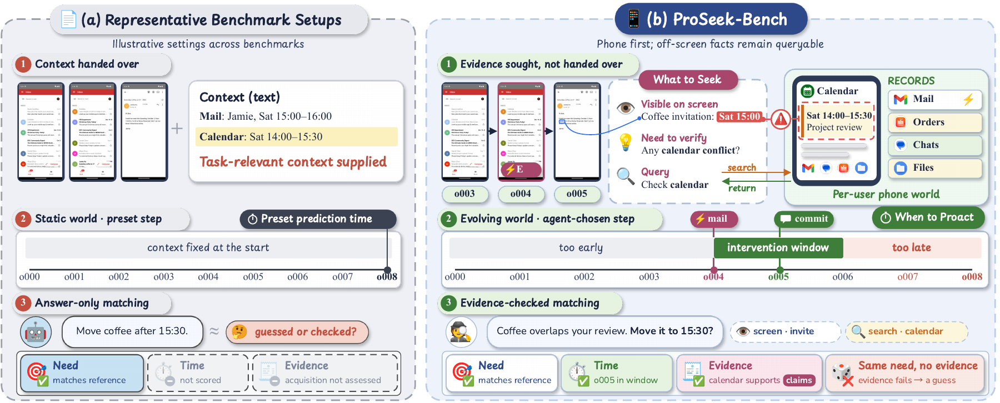
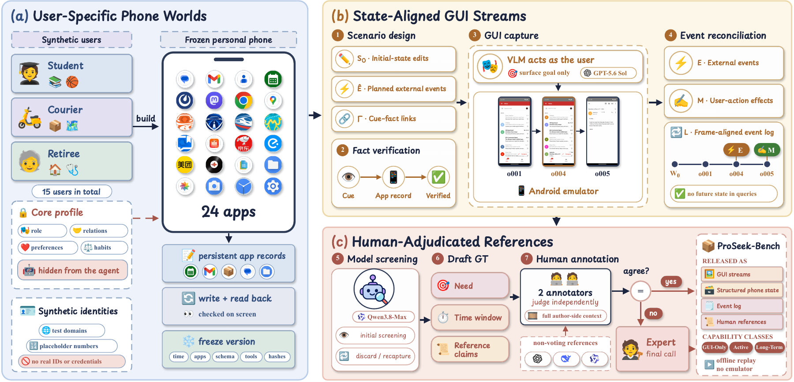
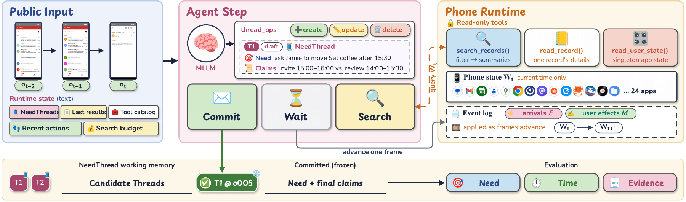

<h1 align="center">ProSeek-Bench</h1>

<strong>Do Mobile Agents Know What to Seek and When to Proact?</strong>

  <a href="#benchmark">Benchmark</a> ·
  <a href="#online-evaluation">Online Evaluation</a> ·
  <a href="#main-results">Main Results</a>

<strong>arXiv:</strong> <!-- Add the link after the preprint is public. -->

  

## Benchmark

ProSeek-Bench evaluates whether mobile agents can recognize unspoken user needs, seek evidence, and offer help at the right time. Each episode pairs a GUI stream with an evolving, queryable phone world.

| Replayable episodes | No-need controls | GUI-Only | Active | Long-Term |
| :---: | :---: | :---: | :---: | :---: |
| **373** | **37** | 122 | 183 | 68 |

<strong>Benchmark construction</strong>

  

## Online Evaluation

The main experiments use a shared **NeedThread** harness that tracks candidate needs and evidence across observations. At each step, the agent can **Search** using read-only tools, **Wait**, or **Commit** an assistance proposal.

  

Human-adjudicated references support three nested checks. **Need** measures alignment with a reference need. **Time** checks the intervention window for the matched option. **Evidence** checks whether the proposal resolves decisive requirements and grounds its factual premises in evidence acquired before commitment.

## Main Results

Overall results across **373 episodes**, sorted by Evidence F1 from lowest to highest. Ties are ordered by Time F1, then Need F1. F1 scores are micro-averaged percentages. **Step** is the mean number of accepted searches per episode.

| Model | Need F1 ↑ | Time F1 ↑ | Evidence F1 ↑ | Step |
| :--- | ---: | ---: | ---: | ---: |
| InternVL3.5-8B | 1.6 | 0.2 | 0.2 | 1.60 |
| Step3-VL-10B | 1.4 | 0.3 | 0.3 | 2.71 |
| GLM-4.6V-Flash (9B) | 0.9 | 0.5 | 0.3 | 1.85 |
| MiMo-VL-7B-SFT | 8.4 | 3.9 | 1.5 | 1.63 |
| Qwen3.5-35B-A3B | 13.9 | 8.5 | 4.3 | 4.65 |
| Gemma-4-31B-IT | 22.5 | 14.5 | 7.8 | 2.45 |
| Qwen3.8-27B | 30.8 | 21.8 | 13.9 | 3.66 |
| GLM-5.3-Flash | 34.6 | 26.6 | 17.7 | 4.35 |
| Doubao-Seed-2.1-Pro | 34.2 | 27.1 | 20.1 | 6.37 |
| Qwen3.8-Flash | 39.8 | 30.6 | 20.8 | 4.92 |
| DeepSeek-V4.1-Flash | 39.7 | 32.5 | 22.3 | 7.41 |
| Kimi-K3.1 Pro | 41.8 | 34.4 | 26.5 | 5.83 |
| **GPT-6.1 Sol** | **61.0** | **50.9** | **42.6** | 9.96 |

[Download the full results (CSV)](assets/main-results.csv), including Recall, F1, and Step for each setting and the overall benchmark.

Search particularly benefits Active episodes. Removing persistent state reduces Long-Term Evidence F1 by **63.9–78.2%** across four models.
